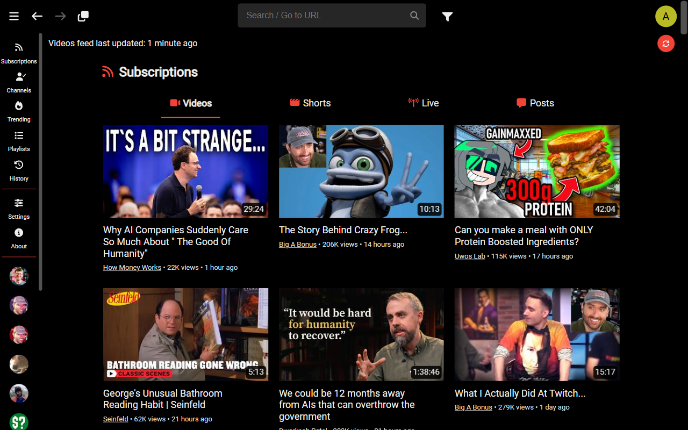
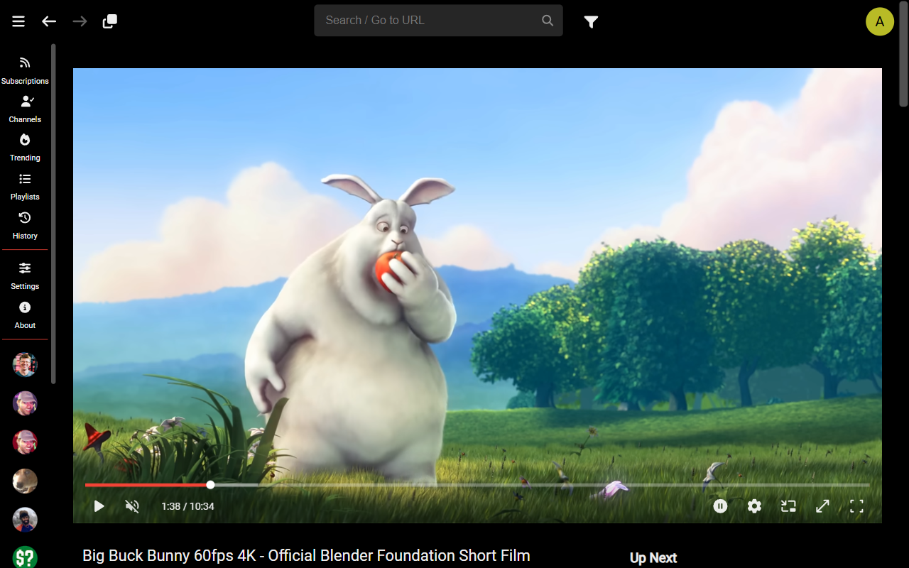
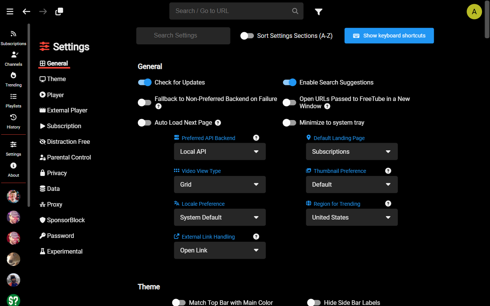

 

FreeTube is an open source desktop YouTube player built with privacy in mind.
Use YouTube without advertisements and prevent Google from tracking you with their cookies and JavaScript.
Available for Windows (10 and later), Mac (macOS 13 and later) & Linux thanks to Electron.

> [!IMPORTANT]
> **This is a single-maintainer fork of [FreeTubeApp/FreeTube](https://github.com/FreeTubeApp/FreeTube).** It is not affiliated with or endorsed by the FreeTube team.
>
> Upstream moves slowly and some bugs have been open for a long time (for example, the subscription reload issues). This fork uses AI-assisted workflows (Claude Code, under human direction) to fix them directly. All code changes here are AI-authored.
>
> - **No external contributions are accepted.** Pull requests from outside parties are closed without review. See [CONTRIBUTING.md](CONTRIBUTING.md).
> - **No feature requests or support.**
> - **Do not report this fork's bugs upstream.** The FreeTube team does not support this fork.
>
> The rest of this README is upstream's, adjusted where it conflicts with this fork.

## How this fork differs from FreeTube

### Playback reliability
- **Videos keep playing past the first minute, and seeking works.** YouTube had started serving FreeTube only about a minute of each video and refusing to stream after a seek (upstream [#10024](https://github.com/FreeTubeApp/FreeTube/issues/10024)). The fork mints its proof-of-origin token the way YouTube's own web player does, and YouTube accepts it.
- **Far fewer "Reloading player at YouTube request" interruptions:**
  - The player tells YouTube accurately which segments it has buffered, so YouTube doesn't stall waiting on a segment it thinks the player already has.
  - Requests that come back empty are retried with a growing delay instead of hundreds of times in a row.
  - A reload loads the video once, not twice in parallel.
- **Protection against IP blocks.** Automatic reloads are capped at two per video in five minutes. Bursts of reloads don't recover playback and can get your IP blocked (HTTP 403).

### Subscriptions and data
- **"Hide upcoming premieres" works** on both the built-in extractor and Invidious; it never filtered anything before.
- **The subscription feed cache is no longer wiped** when profiles fail to load, and feeds no longer come back empty after a restart.
- **Deleting several playlists at once deletes all of them**, not just one.
- **Removing a profile that doesn't exist no longer deletes a different one.**
- **Search history is ordered by last use**, as intended.

### Smaller fixes
- Storyboard previews (seek bar thumbnails) work on videos with long storyboard intervals.
- Fixes for crashes on some video titles, channels without an owner, movie listings, audio-only streams and some channel tag lookups.
- The `%t` screenshot file name placeholder is padded to three digits, as documented.

### Different defaults
- **Black (OLED) theme** instead of following the system theme, with no window flash on start-up.
- **The header logo is hidden.**

Both can be changed under Settings > Theme.

### Releases and updates
- **This fork has its own version numbers, starting at 1.0.0.** The update check looks at this fork's releases, not upstream's.
- **Each release has builds** for Windows, macOS and Linux, on both x64 and arm64.

<a href="https://github.com/AndrewAltimit/FreeTube/releases">Download</a>

<a href="#how-this-fork-differs-from-freetube">Differences</a> &bull; <a href="#screenshots">Screenshots</a> &bull; <a href="#how-does-it-work">How does it work?</a> &bull; <a href="#features">Features</a> &bull; <a href="#download-links">Download Links</a> &bull; <a href="#contributing">Contributing</a> &bull; <a href="#localization">Localization</a> &bull; <a href="#contact">Contact</a> &bull; <a href="#license">License</a>

## Screenshots
| The subscriptions feed |
|---|
|  |

| Watching a video |
|---|
|  |

| Settings |
|---|
|  |

## How does it work?
FreeTube uses a built in extractor to grab and serve data / videos. The [Invidious API](https://github.com/iv-org/invidious) can also optionally be used. FreeTube does not use any official APIs to obtain data. While YouTube can still see your video requests, it can no
longer track you using cookies or JavaScript. Your subscriptions, playlists and history are stored locally on your computer and never sent out.

> [!IMPORTANT]  
> Using a VPN or Tor is highly recommended to hide your IP while using FreeTube.

## Features
* Watch videos without ads
* Use YouTube without Google tracking you using cookies and JavaScript
* Two extractor APIs to choose from (Built in or Invidious)
* Subscribe to channels without an account
* Connect to an externally setup proxy such as Tor
* View and search your local subscriptions, playlists and history
* Organize your subscriptions into "Profiles" to create a more focused feed
* Export & import subscriptions
* YouTube Trending
* YouTube Chapters
* Most popular videos page based on the set Invidious instance
* SponsorBlock
* DeArrow
* Open videos from your browser directly into FreeTube (with extension)
* Watch videos using an external player
* Full Theme support
* Make a screenshot of a video
* Multiple windows
* Mini Player (Picture-in-Picture)
* Keyboard shortcuts
* Option to show only family friendly content
* Show/hide functionality or elements within the app using the distraction free settings
* View channel posts

### Browser Extensions
The following extensions open YouTube links directly in FreeTube:

- [LibRedirect](https://libredirect.manerakai.com/)
- [RedirectTube](https://github.com/MStankiewiczOfficial/RedirectTube)

LibRedirect automatically redirect YouTube links to FreeTube.
> [!IMPORTANT]
> To ensure proper functionality, select FreeTube as Frontend in the Services settings of the extension.

RedirectTube, doesn’t automatically open YouTube links in FreeTube (although this feature can be enabled in the settings). Instead, it adds buttons to the toolbar and context menu, which you can click to open videos in FreeTube manually.

- Download LibRedirect from [Mozilla Add-ons](https://addons.mozilla.org/firefox/addon/libredirect/) (for Firefox based-browsers) or [developer's website](https://libredirect.manerakai.com/download_chromium.html) (for Chrome and Chromium-based browsers).

- Download RedirectTube from [Mozilla Add-ons](https://addons.mozilla.org/firefox/addon/redirecttube/) (for Firefox based-browsers) or [Chrome Web Store](https://chromewebstore.google.com/detail/redirecttube/jpbaggklodpddjcadlebabhiopjkjfjh) (for Chrome and Chromium-based browsers).

> [!NOTE]
> These extensions do not work on Linux portable builds!
>
> If you have issues with the extension working with FreeTube, please create an issue in this repository instead of the extension repository.

## Download Links

> [!CAUTION]
> FreeTube is only supported on Windows 10 and later, macOS 13 and above, and various Linux distributions. Installing it on unsupported systems may result in unexpected issues.

* [GitHub Releases](https://github.com/AndrewAltimit/FreeTube/releases)

Each release has builds for x64 and arm64: a Windows installer (`-setup.exe`), a macOS disk image (`.dmg`), and for Linux an AppImage, a `.deb` and an `.rpm`. To build from source instead, run `pnpm install && pnpm run build`.

## Contributing
This fork does not accept external contributions; see [CONTRIBUTING.md](CONTRIBUTING.md). Development happens on `main`, with feature branches off it.

Thank you very much to the [People and Projects](https://docs.freetubeapp.io/credits/) that make FreeTube possible, and to the upstream FreeTube team, whose work this fork builds on.

## Localization
Translations come from upstream FreeTube and are pulled in when this fork syncs with upstream.

## Contact
This fork offers no support channel.

## License
  

FreeTube is Free Software: You can use, study share and improve it at your
will. Specifically you can redistribute and/or modify it under the terms of the
[GNU Affero General Public License](https://www.gnu.org/licenses/agpl-3.0.html) as
published by the Free Software Foundation, either version 3 of the License, or
(at your option) any later version.  
